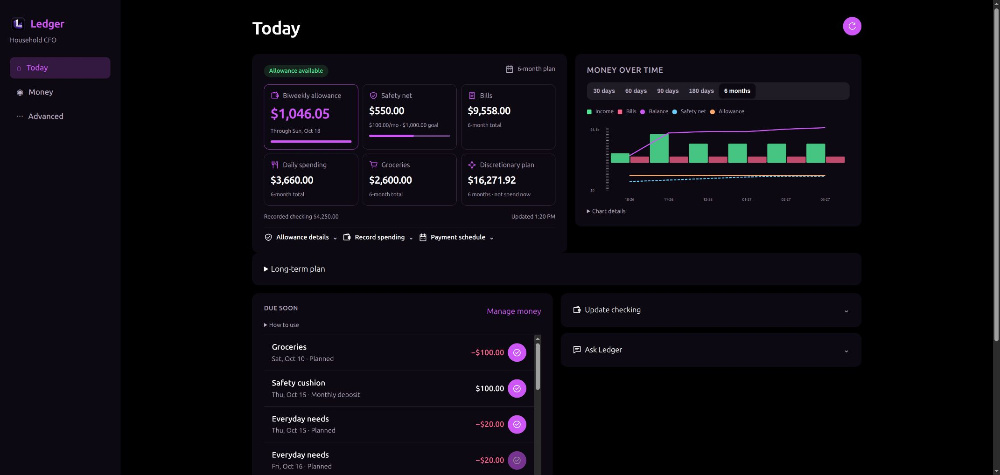
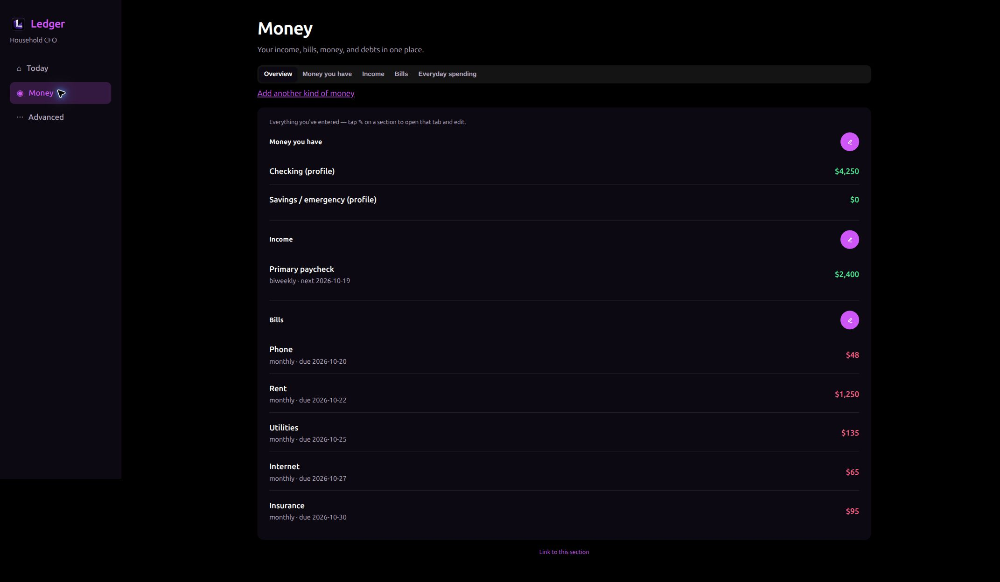
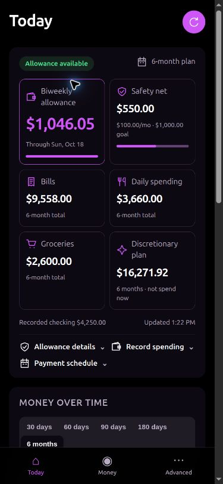

<div align="center">


# Ledger
### Know what you can spend. Keep tomorrow covered.

**Free and open source under MIT, including commercial use.** A local-first personal CFO with a built-in financial AI assistant and advanced cash-flow planning. Cover your bills, build your emergency cushion, and make more room for the things you enjoy—with a conservative allowance that helps your discretionary money last and grow over time.

[Get started](#get-started) · [AI assistant](#your-built-in-financial-ai-assistant) · [Advanced planning](#advanced-planning-to-grow-your-disposable-income) · [Latest release](https://github.com/SketchOTP/Ledger/releases/latest) · [Privacy](docs/privacy.md)


[](LICENSE)

</div>



*Actual Ledger interface. All screenshots use fictional demo data.*

## What’s new in v1.1.0

Ledger is now MIT licensed: use it at home, adapt it for your workflow, or build on it commercially. This release brings together the latest paid/unpaid purchase behavior, conservative biweekly allowance, six-month planning, clear zero/negative-balance messages, and refreshed screenshots from the real app. Existing records remain compatible.

[Download v1.1.0](https://github.com/SketchOTP/Ledger/releases/tag/v1.1.0) · [Explore Ledger on Animus Machinae](https://animusmachinae.com/releases/#ledger)

## Your money, at a glance

Checking balance alone doesn't tell you what you can afford. Ledger looks at dated obligations and expected income at least six calendar months ahead, then shows a practical allowance for the current pay period.

- **See the essentials separately.** Bills, daily spending, groceries, discretionary planning, your biweekly allowance, and the actual emergency cushion each have their own place.
- **Protect future pay periods.** Your allowance accounts for future obligations and keeps breathing room. It doesn't invite you to spend the entire six-month surplus today.
- **Build your emergency cushion.** Plan a monthly contribution toward an adjustable goal. A due-soon deposit stops at the goal and caps the final contribution.
- **Mark purchases paid immediately.** Recorded daily spending, groceries, and discretionary purchases leave remaining cash needs immediately. Ledger plans from the checking balance you enter; update it separately whenever needed.
- **See pressure before payday.** A dated cash-flow chart makes approaching bills and projected shortfalls easier to spot.
- **Keep the page calm.** Three tabs—Today, Money, Advanced—with details tucked behind expandable controls.



<details>
<summary>See the mobile dashboard</summary>



</details>

## Your built-in financial AI assistant

**Ask Ledger** turns your recorded financial picture into a conversation. Open it on **Today** to ask about your bills, understand an allowance, or talk through a purchase before committing.

- **Answers grounded in your plan.** The assistant receives a dated snapshot of your recorded balances, bills, income, spending, debts, household details, and six-month payment plan.
- **Useful what-if discussions.** Ask how an extra expense, a smaller paycheck, or a different payment date could affect you. Proposed scenarios stay illustrative until you update your records and Ledger recalculates.
- **A second look before you spend.** The assistant is instructed to respect your remaining biweekly allowance, protect emergency contributions and future pay periods, and distinguish expected income from money available now.
- **A conversation you control.** Ledger keeps the conversation in the current page session; **New** or a page refresh clears it. The assistant provides explanations and suggestions without changing records or moving money.

> “Why is my allowance lower this pay period?”
>
> “Can I buy groceries on Saturday and still cover the mortgage?”
>
> “What would a $200 repair do to my plan?”

## Advanced planning to grow your disposable income

Ledger's goal is to help you grow the money left for your own choices after bills, daily spending, groceries, and emergency saving. Its planning engine calculates the dollars; optional AI helps explain the picture and explore ways to improve it.

| Capability | What it does for you |
| --- | --- |
| **Six-month cash-flow planning** | Tests dated income and obligations across at least six calendar months, so a comfortable balance today doesn't hide a future shortfall. |
| **Payment timing** | Targets normal due dates and can use a recorded, lender-approved mortgage grace window when needed to resolve a shortfall. |
| **Conservative allowance optimization** | Finds a sustainable equal biweekly allocation across the dated plan, releases 90%, and retains 10% within discretionary planning, while protecting future allowances and extra breathing room. |
| **Room for discretionary growth** | Leaves part of each planned allocation unspent. Cash you actually retain can support greater future capacity; projected surplus is never added to today's spending permission. |
| **Emergency saving on schedule** | Treats monthly cushion contributions as planned obligations, adjusts the final deposit, and stops at your chosen goal. |
| **Household risk planning** | Uses recorded dependents, income risks, transport needs, and upcoming events to model household resilience scenarios. |
| **AI-assisted income-growth ideas** | The optional household advisory engine combines recorded skills, assets, time, and constraints into bounded experiments, with evidence needed and test-capital limits. Ideas remain unverified until supported by facts. |

On **Today**, expand **Long-term plan** when available to see the existing surplus split into **Save**, **Grow**, and **Keep free**. Its **Adjust plan** link opens the household plan, also available at `/household`. **Refresh plan** requests household risk synthesis and growth ideas from the configured provider. These are planning suggestions; they do not create income, transfer money, or increase your current allowance.

<details>
<summary><strong>Enable AI · setup, privacy, and availability</strong></summary>

**Ask Ledger uses Codex CLI.** Install a compatible Codex CLI on the computer running the backend, make `codex` available to that process, and sign in as the same operating-system user that runs Ledger:

```bash
codex login
codex login status
```

In **Advanced → Settings**, choose the **Financial assistant** model and reasoning effort, then save. Return to **Today → Ask Ledger**. The CLI must support Ledger's ephemeral, read-only invocation flags; a missing CLI, sign-in, or incompatible runtime prevents answers.

**The standard Docker image does not bundle Codex CLI or sign-in credentials.** Use the Python installation for the simplest host-based assistant setup, or provision a compatible authenticated CLI inside your own container. Host sign-in alone does not enable chat inside the stock container.

**Household AI synthesis uses a separate provider setting.** In **Advanced → Settings**, configure a supported provider such as LM Studio, an OpenAI-compatible endpoint, or Codex CLI. Assistant model preferences are separate from the planning/research model. Selecting a local provider for household synthesis does not switch Ask Ledger away from Codex. The default `mock` provider produces placeholders; providers marked as unimplemented cannot generate real advice.

**Local storage does not mean every AI request stays local.** Ask Ledger sends the supplied financial snapshot and recent conversation to Codex; other optional AI features send context to their configured provider. Provider retention and processing policies still apply. Ledger does not save assistant conversations in its database. See [privacy and security](docs/privacy.md).

All dated cash-flow calculations, allowance limits, and emergency contribution schedules work without AI. AI answers can be mistaken; the recorded plan remains the reference for spending decisions. Growth experiments are hypotheses, not verified demand, earnings, or guaranteed returns.

</details>

## Get started

### Docker · recommended

Install Docker Engine with Docker Compose, then:

```bash
git clone https://github.com/SketchOTP/Ledger.git
cd Ledger
docker compose up --build -d
```

Open **http://localhost:9543**, create your account, and follow the guided setup. No AI subscription or API key is needed for deterministic planning. Household data persists in the `ledger-data` Docker volume. The service binds to your computer's loopback interface by default.

Already using port 9543? Run `LEDGER_PORT=19543 docker compose up --build -d` and open http://localhost:19543.

To update, back up first, then run `git pull --ff-only` and `docker compose up --build -d`. `docker compose down` stops the app and preserves the volume; **do not add `-v` unless you intend to delete your data**. See [deployment and backups](docs/local-deployment.md).

### Prebuilt release downloads

The [release page](https://github.com/SketchOTP/Ledger/releases/latest) also includes:

- **Ledger-v1.1.0.zip** — reviewed source plus the compiled web interface. Extract it and follow the Python setup below; you can skip the npm commands.
- **Ledger-v1.1.0-linux-amd64-docker.tar.gz** — a ready-built image for x86-64 Linux containers. Download it, then:

```bash
docker load -i Ledger-v1.1.0-linux-amd64-docker.tar.gz
docker run -d --name ledger --restart unless-stopped \
  -p 127.0.0.1:9543:9543 \
  -v ledger-data:/var/lib/ledger sketchotp/ledger:1.1.0
```

Open http://localhost:9543. The release includes SHA-256 checksums. For other architectures, build from source with Compose; the prebuilt image was verified on Linux amd64.

### Python + Node

Requires Python 3.11+ and Node.js 22.18+.

```bash
git clone https://github.com/SketchOTP/Ledger.git
cd Ledger
python3 -m venv .venv
source .venv/bin/activate
python -m pip install -r requirements.txt
cp .env.example .env
npm --prefix frontend ci
npm --prefix frontend run build
python -m app.main
```

Open **http://localhost:9543**. Windows users can activate the environment with `.venv\Scripts\activate` instead. Keep your `.env` and `data/` private. You can set `LEDGERMIND_DATA_DIR` to an absolute path outside the checkout before first launch.

## Make the plan yours

1. Enter your current checking balance, income dates, and recurring bills. Record grace dates only when your lender actually allows them.
2. Set your daily and grocery budgets. For example, $30 a day and $150 each Saturday are distinct from discretionary spending.
3. Enter the emergency money you already have, choose a goal, and set the monthly contribution—for example, $100 monthly until $1,000.
4. Enable the conservative biweekly allowance in your cash profile. Check **Today** before discretionary purchases; record spending and keep balances and payment status current.

The allowance releases 90% of the maximum sustainable equal biweekly allocation tested against the dated plan, while retaining 10% within discretionary planning and protecting an additional allocation of breathing room. Future income is a forecast, not cash available today. The separate **six-month discretionary plan** is a planning total, not permission to spend it all. [Read the calculation details](docs/planning.md).

## Local-first by design

Ledger stores account and household records locally in SQLite, with separate household databases for each login. It does not connect to your bank, move money, or pay bills automatically. Optional AI and research integrations may send data to the providers you configure; review [privacy](docs/privacy.md) before enabling them. The default `mock` AI provider returns placeholders.

The plan depends on the balances, dates, budgets, and payment records you supply. It cannot see unrecorded purchases or guarantee that an expected paycheck arrives. Ledger is budgeting software and does not provide licensed financial advice or guarantees about future outcomes.

## Development

```bash
python -m pip install -c requirements.lock -e '.[dev]'
ruff check .
pytest -q
node scripts/test_reserve_projection.mjs
npm --prefix frontend ci
npm --prefix frontend run build
```

Backend: FastAPI + SQLModel + SQLite. Frontend: React + TypeScript + Vite. Deterministic calculations precede optional AI explanations. Internal `LEDGERMIND_*` setting names are retained for compatibility.

## License

Copyright 2026 SketchOTP. Ledger v1.1.0 and later are **[MIT licensed](LICENSE)**: free to use, modify, redistribute, and use commercially, subject to retaining the copyright and permission notice. No separate commercial permission is required. Earlier release archives keep their original license notices. Third-party components retain their own terms; see [NOTICE](NOTICE) and [third-party notices](THIRD_PARTY_NOTICES.md).
